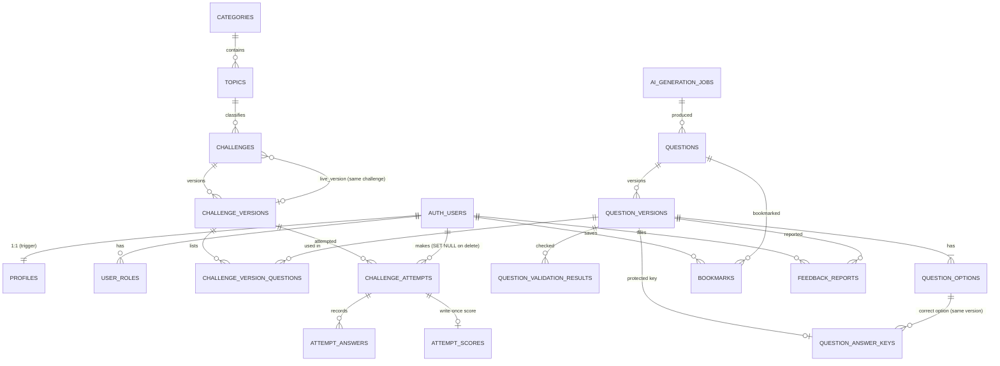

# Architecture (Phase 1)

## Shape

```
Browser (React SPA, Cloudflare Pages)
   |  supabase-js, publishable key only
   v
Supabase
   |- Auth            email + Google, PKCE flow
   |- PostgREST       tables and views, guarded by grants + RLS
   |- RPC functions   is_admin(), admin_overview_stats()
   '- PostgreSQL      the source of truth for access rules and integrity
```

No custom server exists in Phase 1. Edge Functions arrive in later phases (AI generation, attempt submission) and will use the `service_role` key, which exists only in Supabase's server-side secret store.

## Principles that shaped the code

1. **The database is the security boundary.** Route guards in React are a usability layer. Every read and write is independently checked by grants and RLS.
2. **Deny by default.** Migration 1 removes default privileges; migration 8 revokes everything, then grants table by table. A test fails if anything extra is exposed.
3. **History is immutable.** Questions and challenges are versioned; attempts pin a `challenge_version`; triggers freeze locked versions, submitted attempts and scores.
4. **Answer keys are separate.** `question_answer_keys` holds the correct option and explanation. Students have no policy on it.
5. **No invented numbers.** Every metric is computed from rows and printed with its definition ([analytics-definitions.md](analytics-definitions.md)).

## Route map

| Route | Access | Phase 1 status |
|---|---|---|
| `/` | public | built |
| `/login`, `/register`, `/forgot-password` | public (signed-in users are redirected away) | built |
| `/reset-password` | via emailed link | built |
| `/auth/callback` | OAuth / email-link return | built |
| `/dashboard`, `/profile` | signed in | built |
| `/admin` | administrator | built (overview only) |
| `/challenges`, `/challenges/:slug`, `/attempt`, `/results/:id`, `/leaderboard`, `/history` | signed in | **not built** (phases 2, 3, 5) |
| `/admin/challenges`, `/admin/ai-generator`, `/admin/review`, `/admin/analytics`, `/admin/settings` | administrator | **not built** (phases 2, 4, 5) |

Unbuilt routes are deliberately not linked anywhere; they render the 404 page.

## Sign-in flow

1. `signInWithPassword` / `signInWithOAuth` (PKCE). OAuth returns to `/auth/callback`, where supabase-js exchanges the code.
2. `AuthProvider` listens to auth events, holds the session, and loads roles and profile with TanStack Query.
3. A trigger on `auth.users` created the profile and the `USER` role at sign-up. Roles are never derived from user-editable metadata.
4. `RequireAuth` waits for the session before redirecting (no flash). `RequireAdmin` waits for roles; a failed or malformed roles response **fails closed** (not admin) and offers a retry.
5. The post-login destination is validated by `safeNextPath` (blocks `//host`, backslashes, control characters, dot-segment tricks, auth-screen loops).

## Data model


Also present: `audit_logs` (append-only, no foreign keys) and `app_settings` (key/value limits).

### Integrity rules enforced by the database

- An answer must belong to the attempt **and** to a question in the attempt's pinned version; the chosen option must belong to that question (composite foreign keys).
- A correct option must belong to the same question version as its key.
- A challenge's live version must belong to that challenge; `PUBLISHED` requires a live version and a topic.
- One running attempt per user and challenge; unique attempt numbers.
- Locked question versions, their options and keys; frozen challenge versions and question lists; submitted attempts and their answers; and scores cannot be modified or deleted.
- Deleting an account anonymises its attempts (`user_id` becomes null) and keeps the aggregate history.
- Audit log rows can never be updated, deleted or truncated.

## Decisions and trade-offs

| Decision | Why | Cost |
|---|---|---|
| Supabase instead of Express + Prisma | one fewer server to host; RLS is a strong boundary; free tier | logic splits between SQL and Edge Functions |
| No generated DB types yet | `supabase gen types` needs a live database; responses are validated with Zod at the boundary instead | less compile-time help until types are generated |
| Students get no direct read on questions | questions will be delivered by a function that omits the key | requires a function in phase 3 |
| Profiles are readable only by their owner (and admin) | privacy: other students' names are not exposed | leaderboards (phase 5) need a controlled view |
| Enums for statuses | invalid states impossible | adding a value needs a migration |
| `lucide-react` not installed | no icons needed yet | add when first used |
